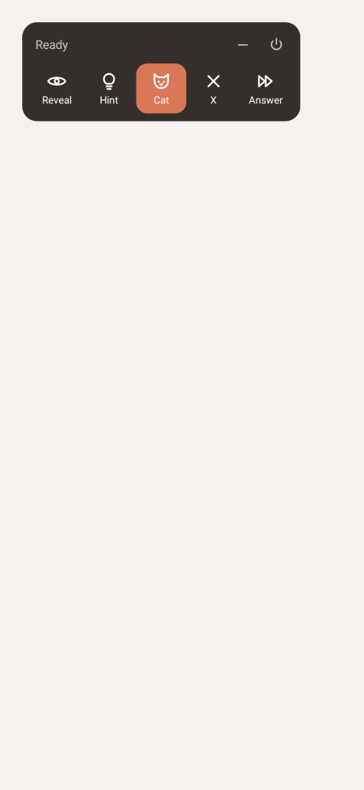
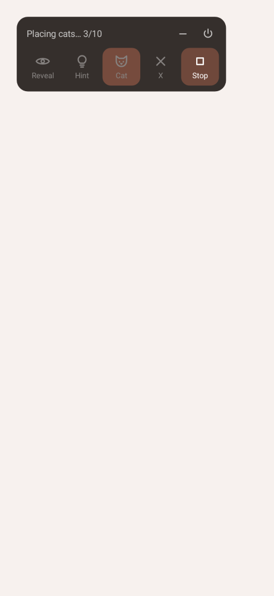
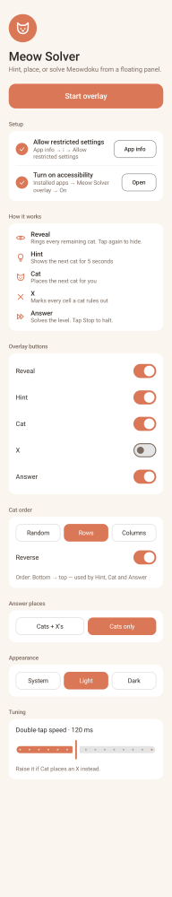
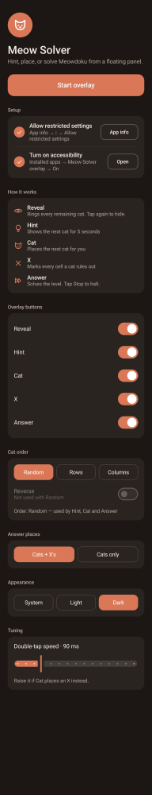

# Meow Solver

Android overlay that reads a **Meowdoku** puzzle from the screen, solves it, and can place the cats and X's for you.

Meowdoku rules: one cat per row, column and colour region; no two cats touch, not even diagonally.

| Panel | Answer running | Setup (light) | Setup (dark) |
|---|---|---|---|
|  |  |  |  |

## Download
**[⬇ Download MeowSolver-v2.9.apk](https://github.com/IlanKog99/meow-solver/releases/download/v2.9/MeowSolver-v2.9.apk)** (Android 11+, ~1.6 MB) · [all releases](https://github.com/IlanKog99/meow-solver/releases)

## Setup
1. Install the APK and open **Meow Solver**.
2. **App info → ⋮ → Allow restricted settings** (needed for sideloaded accessibility apps).
3. **Accessibility → Installed apps → Meow Solver overlay → On**.
4. Tap **Start overlay**, then open a Meowdoku level.

## Overlay buttons
| Button | Does |
|---|---|
| Reveal | Rings every remaining solution cell (toggle) |
| Hint | Shows the next cat for 5 s |
| Cat | Places the next cat (the hinted one if a hint is showing) |
| X | From one screen read: marks every cell the placed cats rule out (colour, row, column, 3x3 ring), by dragging. Reports X's sitting on cells where a cat belongs, and clears them when **Remove wrong X's** is on |
| Answer | Solves the level: places all cats (and X's), re-checks the board, places the last cat. Tap **Stop** to halt |

Minimize to a small bubble; drag the panel by its status text (or the cat grip in grid layouts); power icon closes it.

## Settings (setup screen)
- **Overlay buttons** — choose which buttons show (at least one).
- **Overlay layout** — Row · Column · 2 wide · 3 wide, plus **Edit button order** (drag the buttons, then Save).
- **Cat order** — Random · Rows · Columns, plus Reverse (top→bottom, bottom→top, left→right, right→left). Used by Hint, Cat and Answer.
- **Answer places** — Cats + X's, or Cats only.
- **X button → Remove wrong X's** — X also clears X's on cells where a cat belongs (off by default).
- **Appearance** — System · Light · Dark.
- **Double-tap speed** — raise it if Cat places an X instead of a cat.

## How it works
- `AccessibilityService` takes a screenshot, finds the grid from colour profiles, clusters cell colours into regions and reads each cell (empty / X / cat).
- Backtracking solver with bit masks; taps are sent with `dispatchGesture` (single tap = X, double tap = cat, drag from an empty cell = X's along the path, drag from an X = clear along the path).
- Answer: one read → plan all cats but one on a virtual board (no cell tapped twice) → taps → re-read → last cat, or up to 3 fix rounds if a tap was missed.

## Build
Kotlin 2.0 · Jetpack Compose · minSdk 30 · targetSdk 35.
```bash
./gradlew assembleRelease testDebugUnitTest   # needs ANDROID_HOME set
```
Signing: releases from v2.7 use one fixed key so each new APK installs as an update. The keystore is kept out of this public repo; the build reads `signing.properties` (storeFile, storePassword, keyAlias, keyPassword) from `$MEOW_SIGNING` or the project's private shared folder, and falls back to the debug key when it's missing (fine for local builds, but such an APK won't update a release install).

Tests: board reading against 41 real level screenshots, solver, move planner, auto-solve simulation, settings, and Paparazzi UI snapshots.

Design docs: [`docs/superpowers`](docs/superpowers).

Meowdoku is a third-party game; this project is an unofficial fan-made helper.
